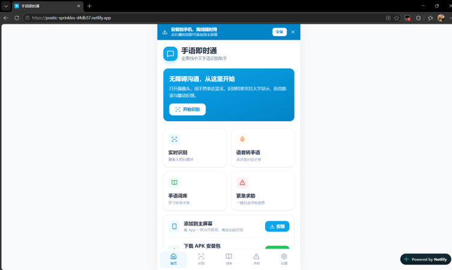
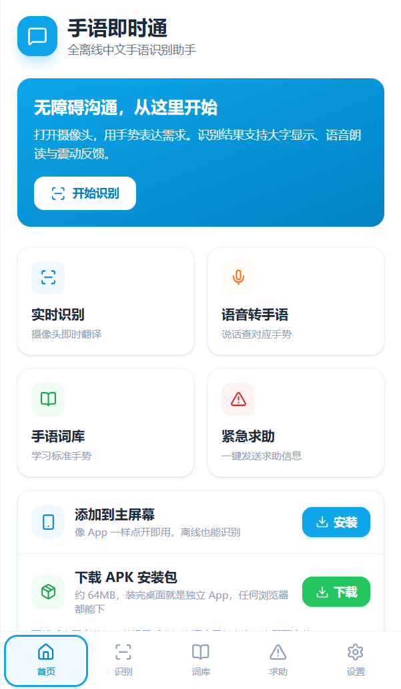
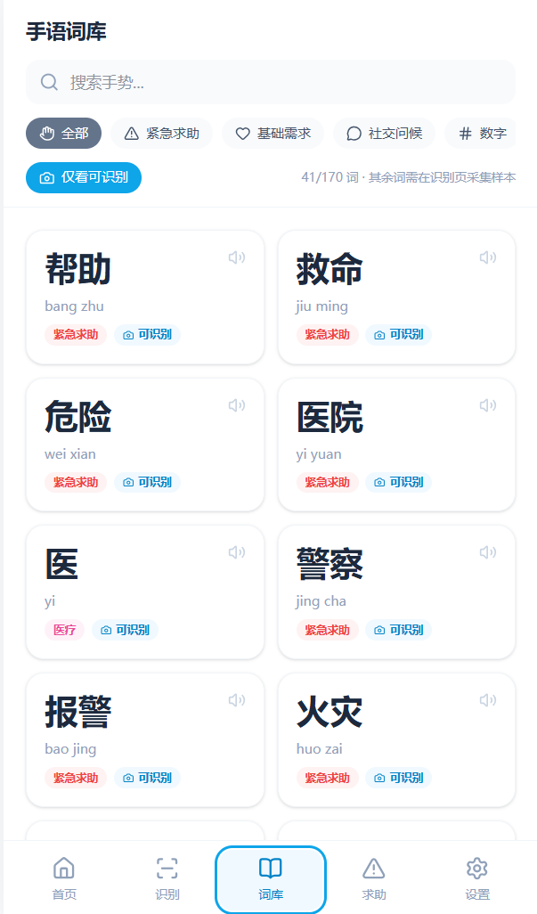
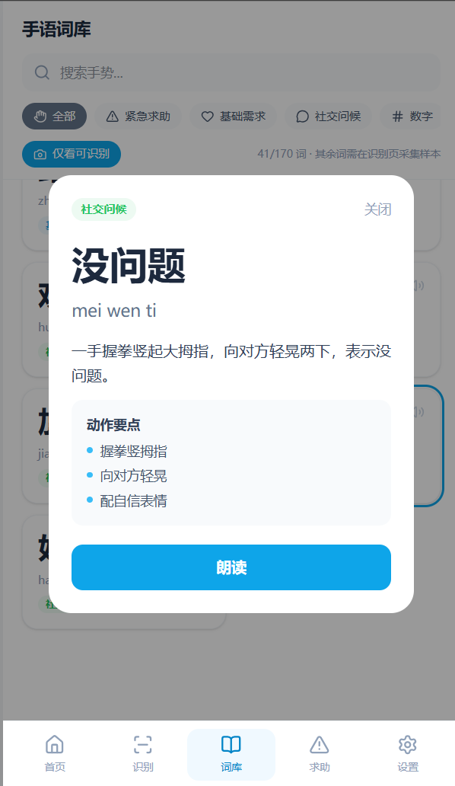
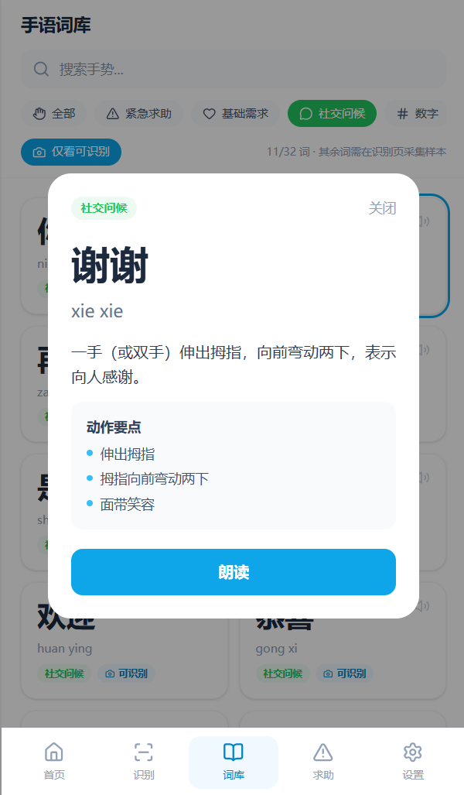
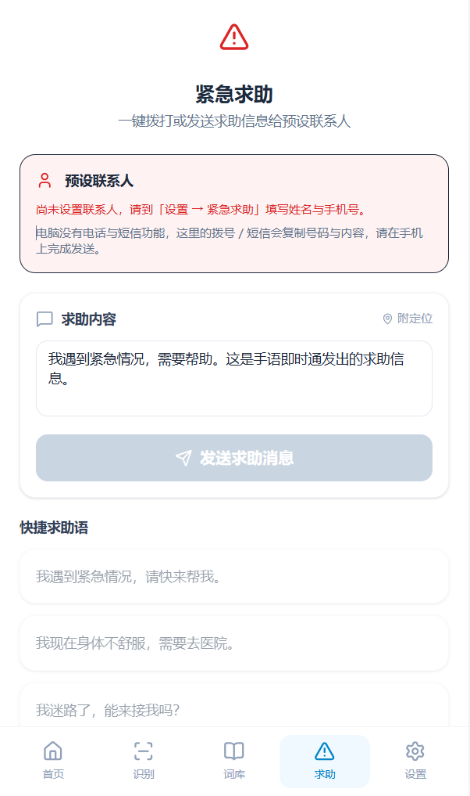
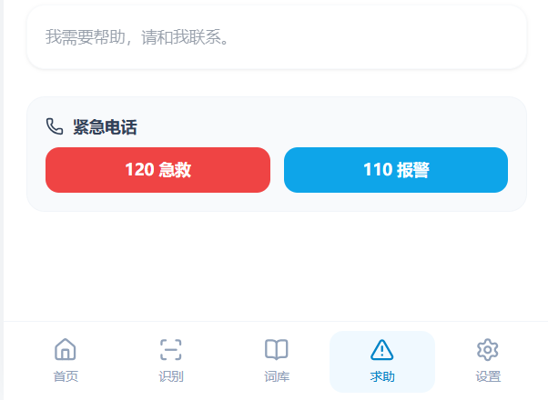
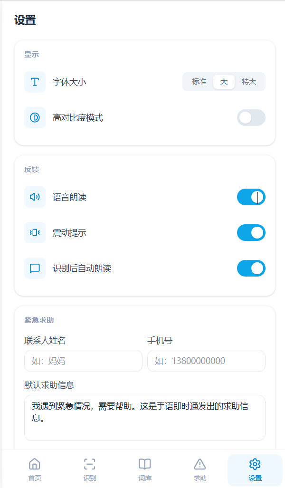
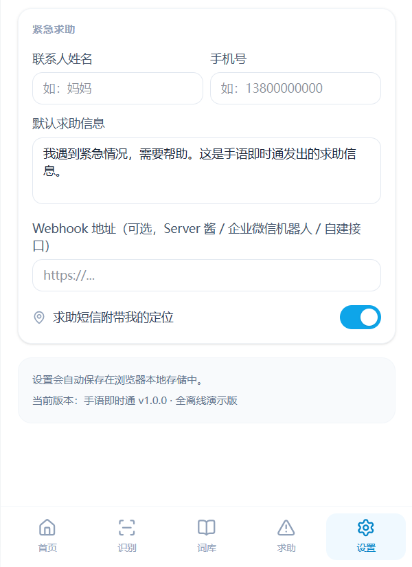

# 手语即时通

> 面向听障人群的**实时、离线、易获取**中文手语识别系统

**在线演示：** https://poetic-sprinkles-d4db57.netlify.app

---

## 一、项目简介

手语是听障人士的主要交流方式，而健听人群普遍缺乏手语能力，二者之间存在显著的沟通壁垒。我国听障人群数量庞大，在日常沟通、就医、办事等场景中“沟通难”问题突出。

“手语即时通”是一套**实时、离线、易获取**的中文手语识别系统。项目借助计算机视觉与人工智能技术，将手语动作转化为可理解的信息，旨在降低沟通门槛、助力信息无障碍建设。

系统无需安装复杂环境、无需联网即可在普通设备上运行，用户通过浏览器调用摄像头，或在手机上安装应用，即可进行手势采集与识别。

## 二、功能特性

- **实时手语识别**：基于 Google MediaPipe（Hands / Pose / Holistic）模型，实时检测手部关键点与人体姿态，进行中文手语识别。
- **全离线推理**：识别模型在本地设备运行，无需联网，在保障用户隐私的同时降低响应延迟。
- **多端覆盖**：提供 Web 端（PWA，可安装、支持离线）与 Android 移动端（APK）两种使用方式。
- **易获取**：无需注册、无需下载大型安装包，浏览器打开即用；手机端提供可安装的 APK。
- **公开部署**：系统已发布至公开网址，便于演示、测试与推广。

## 三、技术架构

| 层级 | 技术选型 |
| --- | --- |
| 视觉 / 识别核心 | Google MediaPipe —— Hands（手部关键点）、Pose（姿态估计）、Holistic（全身融合）模型 |
| Web 前端 | HTML / CSS / JavaScript，构建为 PWA（可安装、支持离线） |
| 移动端 | Android 应用（APK 安装包） |
| 运行环境 | MediaPipe wasm 运行环境经 jsDelivr CDN 加载；识别模型文件托管于本项目 `mediapipe/` 目录 |

## 四、目录结构

```
手语即时通/
├── index.html                 # Web 应用入口
├── assets/                    # 前端构建资源（JS / CSS）
├── mediapipe/                 # 手语识别模型文件（.tflite）
│   ├── hand_landmark_full.tflite
│   └── pose_landmark_full.tflite
├── shouyu-app-v1.0.apk        # Android 安装包
├── manifest.webmanifest       # PWA 配置文件
├── images/                    # 功能展示图片
└── README.md
```

## 五、使用方式

### Web 端

使用支持摄像头的浏览器，通过 `http/https` 地址打开 `index.html`。

> ⚠️ 注意：不能直接双击用 `file://` 方式打开，否则浏览器安全策略会阻止模型与摄像头加载。需通过本地服务器或静态托管访问（如 GitHub Pages、Netlify）。

### Android 端

安装 `shouyu-app-v1.0.apk` 后打开使用（APK 为 WebView 外壳，加载上述 Web 应用）。

## 六、在线演示

- 项目公开地址：**https://poetic-sprinkles-d4db57.netlify.app**
- 本仓库亦可通过 GitHub Pages 部署，得到形如 `https://<用户名>.github.io/<仓库名>/` 的永久公开网址。

## 七、功能展示

<p align="center">
  
  
</p>
<p align="center">
  
  
</p>
<p align="center">
  
  
</p>
<p align="center">
  
  
</p>
<p align="center">
  
  
</p>
<p align="center">
  
</p>

## 八、项目进展与成果

项目分阶段推进，整体进度符合预期：

| 阶段（起止时间） | 研究内容 | 完成情况 |
| --- | --- | --- |
| 2025.05—2025.07 | 需求分析与方案论证 | 已完成 |
| 2025.08—2025.10 | 技术选型与模型集成 | 已完成 |
| 2025.11—2026.01 | Web 前端开发与功能实现（含 PWA） | 已完成 |
| 2026.02—2026.04 | 移动端与系统集成（APK + 合并版） | 基本完成 |
| 2026.05—至今 | 测试优化与公开部署 | 进行中 |

**已取得成果：**

1. 手语即时通 Web 应用系统（已公开部署）
2. 手语即时通 Android 移动端应用（APK 安装包）
3. 基于 MediaPipe 的实时手语识别核心算法
4. 项目技术文档与用户使用说明文档

## 九、当前局限

- 受限于训练数据与手语词库规模，当前系统可识别的手势类别有限，对复杂连续手语的识别准确率仍需提升。
- 在复杂光照、复杂背景及不同摄像头参数下，关键点检测的稳定性有待加强。
- 在模型轻量化与低端设备性能优化方面仍需进一步工作。
- 尚缺乏真实用户的系统性测试与反馈。

## 十、后期工作计划

- 扩充手语数据集与词库，提升系统可识别手势的覆盖面与准确性。
- 优化识别模型与算法，增强在复杂环境下的鲁棒性与实时性，并推进模型轻量化以适配更多低端设备。
- 增加“文字—语音—手语”双向转换功能，完善沟通闭环，提升实用价值。
- 开展真实用户测试，收集反馈并迭代优化交互体验与界面设计。
- 整理技术成果，申报软件著作权，并积极准备参加相关学科竞赛与展示活动。

## 十一、部署说明

本仓库为静态网站，可托管到任意静态服务器，或启用以下方式直接发布：

- **GitHub Pages**：仓库 Settings → Pages → Source 选择 `Deploy from a branch` → Branch 选 `main` 与 `/ (root)` → Save。
- **Netlify**：直接拖拽本仓库文件夹至 Netlify，或连接 GitHub 仓库自动部署。

---

*手语即时通*
